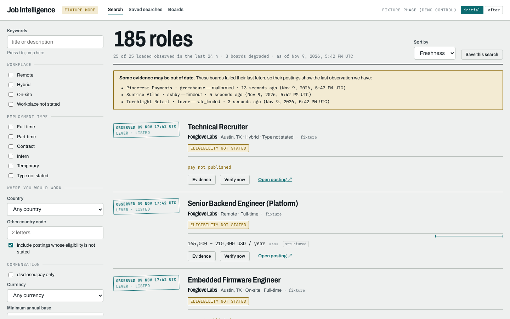

# Job Intelligence

**A job search with an audit trail.**

A job result is only as useful as its source and freshness. Job Intelligence preserves where compensation and eligibility statements came from, including what remains unknown.

Built by **Mohammed Abumtary** · TypeScript · React · Hono · PostgreSQL · MCP · employer-board adapters

[Demo guide](docs/DEMO.md) · [Engineering notes](docs/ENGINEERING.md) · [Verification & boundaries](docs/VERIFICATION.md) · [Recorded walkthrough](media/walkthrough.mp4)

## The experience

Search → compare evidence → inspect source and freshness → save.

Fixture-first demonstration with fictional boards. Greenhouse, Ashby and Lever adapters use explicitly configured sources; the application is read-only.

## Where the engineering matters

### Keep evidence beside normalized fields

Raw snapshots and observations accompany normalized postings. Published pay and inferred or missing units are kept distinct.

### Separate absence from a failed fetch

A provider outage produces an unverifiable observation rather than silently marking a role removed.

### Expose one service through UI and MCP

Search, detail and verification share the same services across the web application and a local MCP interface.

## Verified in the demonstration

- 19 database regressions and five browser checks passed in the current verification pass.
- The fixture collection covers 30 configured boards across three provider formats.
- The walkthrough shows search, compensation evidence and source freshness.

## Explore the work

This private repository is a presentation package: screenshots, walkthrough media and engineering notes. Application source, credentials and customer records are not included. The interactive demonstration runs in a separate local review environment; access can be arranged for a walkthrough.

[Read the guided demo](docs/DEMO.md) · [View my portfolio](https://mohammed-ab.github.io/)

## Scope

The showcased search results are fixtures, not current job recommendations. Coverage is limited to configured boards. No applications are submitted and no inbox is read.

Reviewed 10 November 2026. Results describe the recorded build and stated test scope.
